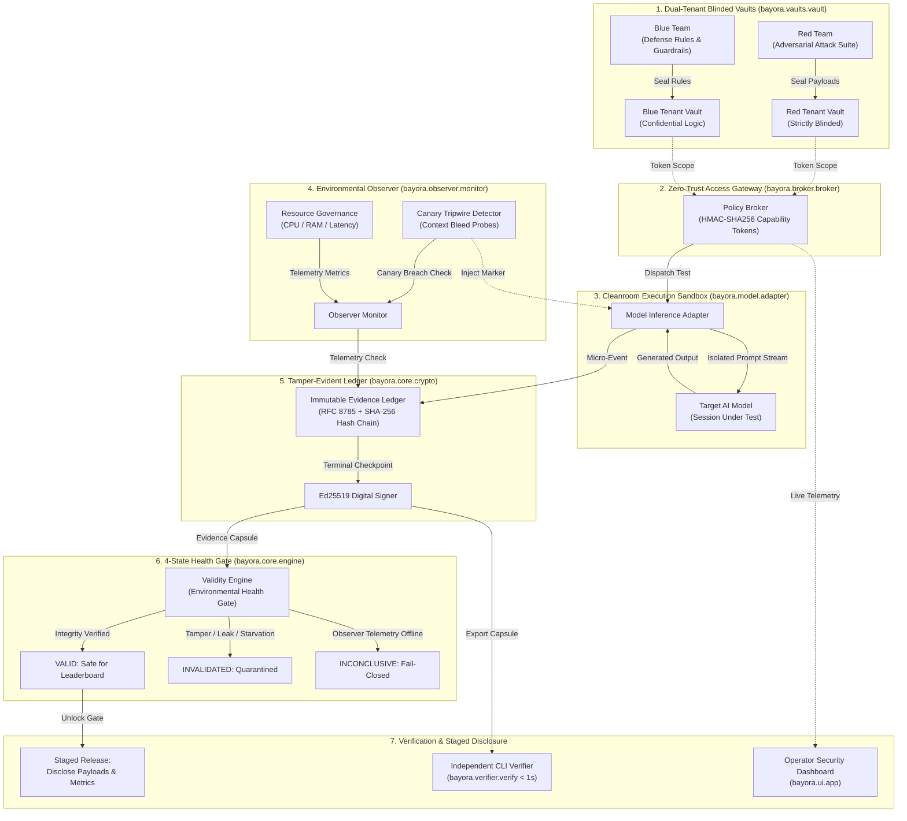

# 🛡️ Bayora V.E.R.I.T.Y
### **Validation of Evidence, Results, Isolation, Trust and Yield**

> **Zero-Trust Cryptographic Infrastructure for Adversarial AI Safety & Evaluation.**  
> *Bayora does not just check whether an AI model passed a test; it cryptographically proves whether the testing environment itself remained trustworthy, uncontaminated, and valid.*

---

## 👥 Engineering Team & Core Domains

| Name | Role & Domain | Responsibilities in Bayora |
| :--- | :--- | :--- |
| **Akash Rawat** | **AI Evaluation and Defense** | Designed the automated adversarial test suite, prompt execution pipelines, active canary markers for context bleeding, and the 4-state environmental health engine. |
| **Tejas Chandane** | **Cybersecurity, Containment and Prompt Injection** | Engineered the disposable cleanroom sandbox, dual-sided blinded release vaults, HMAC capability token boundaries, and prompt injection attack vectors. |
| **Sarthak Bangar** | **Database and UI** | Architected the SHA-256 hash-chained immutable evidence ledger, high-throughput asynchronous telemetry capture, and the tactical obsidian evaluation dashboard. |

---

## 💡 What Bayora Solves: The Five Crises of AI Safety Evaluation

Imagine an adversarial safety evaluation as **three parties in three locked rooms**:
1. **The Attacker (Red Team):** Submits high-risk adversarial prompts and jailbreaks.
2. **The Defender (Blue Team):** Deploys proprietary defense guardrails and filtering regexes.
3. **The AI Model (Subject under Test):** Generates responses without leaking confidential data or carrying context between sessions.

### Why Standard Runners Fail
Traditional evaluation frameworks (e.g., standard pytest scripts or container runners) put these three in basic Docker containers, check if the process returned `exit code 0`, and report **`PASS`**. In reality:
* **Crisis 1: Silent Log Editing & Cherry-Picking:** Standard output logs are raw JSON or CSV files stored on disk. Anyone with filesystem access can delete failed test rows, modify scores, or forge a passing leaderboard report after the fact.
* **Crisis 2: Context Bleeding & Memory Leaks:** Modern LLM servers reuse memory caches or prefix KV-caches. If an evaluation test leaks sensitive data into a subsequent test session, standard runners never notice.
* **Crisis 3: Silent Crashes & Throttled Starvation:** When a model hangs, hits memory ceilings, or experiences observer blackouts, naive runners often mask the failure and falsely accept the run.
* **Crisis 4: Premature Zero-Day & Defense Leakage:** If attack suites or defense rules leak before the run is finalized, both sides can game the test.
* **Crisis 5: Complete Lack of Independent Verifiability:** Regulators, enterprise buyers, and external auditors are forced to blindly trust vendor-generated PDF reports or self-reported scores.

### How Bayora Solves This
Bayora acts as an **independent zero-trust cryptographic referee**:
* **Blinded Dual-Tenant Vaults:** Red-team attacks and Blue-team defenses are held in sealed vaults isolated by HMAC capability tokens. Attack payloads are cryptographically locked until the run is verified clean.
* **Active Canary Tripwires:** Invisible synthetic canary markers are embedded into prompt streams. If an LLM echoes tokens from earlier sessions, Bayora detects the memory contamination and halts the run.
* **Deterministic 4-State Environmental Health Gate:** Instead of binary Pass/Fail, Bayora checks hardware vitals (CPU, memory, timeouts) and observer connectivity. Crashes or blackouts trigger an instant `INVALIDATED` or `INCONCLUSIVE` verdict.
* **RFC 8785 Hash-Chained Evidence Ledger:** Every micro-event is hashed with SHA-256 and chained into an immutable timeline, signed with the evaluator's **Ed25519 digital key**.
* **Sub-Second Independent Verification:** Third parties can verify the signed `clean_capsule.json` offline in **< 1 second** using `bayora verify --file capsule.json`.

---

## 🏗️ System Architecture Diagram



---

## 🔄 End-to-End Userflow: How an Evaluation Runs

```mermaid
sequenceDiagram
    autonumber
    actor Operator as Operator / Auditor
    participant CLI as Bayora CLI / Web HUD
    participant Broker as Policy Broker
    participant Vault as Blinded Vaults
    participant Sandbox as Cleanroom Sandbox
    participant Observer as Environmental Observer
    participant Engine as Health Gate Engine
    participant Verifier as Offline Verifier

    Operator->>CLI: 1. Launch Run: bayora run --scenario clean --export capsule.json
    CLI->>Broker: 2. Initialize Run & Issue Scoped HMAC Tokens
    Broker->>Vault: 3. Store & Fingerprint Test Suites (SHA-256)
    Vault-->>Broker: 4. Return Pre-Run Manifest Digest
    
    loop For Each Adversarial Test Case
        Broker->>Sandbox: 5. Dispatch Prompt with Dynamic Canary Marker
        Observer->>Observer: 6. Measure Real-Time CPU, Memory & Latency
        Sandbox->>Sandbox: 7. Execute AI Inference in Ephemeral Session
        Sandbox-->>Observer: 8. Inspect Output for Leaked Canary Tokens
        Sandbox->>Broker: 9. Record Micro-Event to SHA-256 Hash Chain
    end

    Broker->>Engine: 10. Generate Terminal Checkpoint & Sign with Ed25519 Key
    Engine->>Engine: 11. Verify Hash Continuity, Check Canaries & Resource Limits
    
    alt Run is Completely Clean & Intact
        Engine-->>Broker: Verdict: VALID (INTEGRITY_VERIFIED)
        Broker->>Vault: 12. Unlock Staged Release of Prompts
        Broker-->>CLI: 13. Output Signed Evidence Capsule (clean_capsule.json)
    else Context Bleed / Log Tamper / CPU Spike
        Engine-->>Broker: Verdict: INVALIDATED (CANARY_BREACH / RESOURCE_EXCEEDED)
        Broker->>Vault: 12. Permanently Quarantine Payloads (Release Blocked)
        Broker-->>CLI: 13. Output Diagnostic Failure Report
    end

    Operator->>Verifier: 14. Independent Offline Audit: bayora verify --file capsule.json
    Verifier-->>Operator: 15. [OK] Cryptographically Proven in &lt; 1 Second
```

---

## ⚙️ Core Architecture: The 4-Stage Protocol

Bayora executes every evaluation round through a strict **Seal → Run → Verify → Release** lifecycle:

```
[ STAGE 1: SEAL ] ──> [ STAGE 2: RUN ] ──> [ STAGE 3: VERIFY ] ──> [ STAGE 4: RELEASE ]
 Locked Vaults &        Cleanroom Container &     Telemetry & Canary         Ed25519 Signed Proof &
 Pre-Run Manifest         Active Tripwires          Health Gate Engine         Timed Payload Reveal
```

1. **SEAL (Pre-Run State Commitment):**  
   Before any test runs, the test suite, defense rules, model parameters, and resource budgets are fingerprinted into a canonical `RunManifest` (RFC 8785 + SHA-256).
2. **RUN (Contained Sandbox Execution):**  
   The AI model runs in an isolated cleanroom process. Prompts are fetched in-memory via temporary HMAC capability tokens—never written to unencrypted shared disks.
3. **VERIFY (Environmental Health & Cryptographic Check):**  
   Our 4-state engine checks canary integrity and hardware vitals. If memory leaked or logs were altered, the run is immediately rejected.
4. **RELEASE (Authenticated Disclosure):**  
   Only when the run achieves a cryptographically verified `VALID` verdict are attack prompts and defense metrics released for official leaderboard scoring.

---

## 🌟 Unique Value Propositions (USPs)

1. **Enforcement-Point Cryptographic Proof (RFC 8785 + Ed25519):**  
   Generates an unbroken SHA-256 hash chain anchored by Ed25519 digital signatures using strict canonical serialization (RFC 8785). An auditor can verify the test trail offline in **< 1 second** with zero access to our servers. Modifying even 1 byte in history invalidates the entire chain.

2. **Four-State Environmental Health Gate (Beyond Naive Pass/Fail):**  
   Decouples model output from execution integrity using a deterministic 4-state engine (`VALID`, `INVALIDATED`, `INCONCLUSIVE`, `NOT EVALUATED`). Technical failures and observer blackouts immediately disqualify the run instead of faking a passing score.

3. **Active Canary Tripwires for Context Bleeding:**  
   Automatically injects synthetic canary markers into prompt streams. If an LLM echoes or recalls tokens from a previous session due to context bleeding or caching, our tripwire triggers an instant `CANARY_BREACH_DETECTED` invalidation.

4. **Dual-Tenant Blinded Release Vaults:**  
   Holds proprietary attack payloads in encrypted isolation behind HMAC capability tokens. Test payloads are physically prevented from releasing until the evaluation run is cryptographically verified as clean and uncorrupted.

---

## 📊 Empirical Benchmark Results

Evaluated across **9 controlled conditions** against a standard conventional test harness (tested on Windows 11 Enterprise x86_64, Python 3.14):

| Metric / Scenario | Standard Runner | Bayora V.E.R.I.T.Y | Impact |
| :--- | :---: | :---: | :---: |
| **False Acceptance Rate** *(Corrupted runs marked PASS)* | **100.0%** *(8 of 8 passed)* | **0.0%** *(0 of 8 passed, all caught)* | **100% elimination of false passes** |
| **Tamper Detection Rate** *(Log & signature tampering)* | **0.0%** *(0 of 4 caught)* | **100.0%** *(4 of 4 caught)* | **Cryptographic proof via Ed25519** |
| **Runtime Overhead** *(Median execution penalty)* | **0.0 ms** | **~5.5 ms median** | **< 0.05% overhead (imperceptible)** |

### ⚡ Verification Latency Budget (~5.5 ms Total Overhead)
* **33% (~1.8 ms) — Digital Signature & Proof:** Locks results with Ed25519 attestation so they cannot be faked.
* **27% (~1.5 ms) — Memory & Sandbox Safety:** Validates cleanroom heap integrity and wipes ephemeral sandboxes.
* **22% (~1.2 ms) — Tamper-Proof Log Checks:** Chains run history using RFC 8785 deterministic JSON and SHA-256.
* **18% (~1.0 ms) — Vault Access Control:** Checks zero-knowledge capability tokens and secret boundaries.

---

## 🚀 Quickstart & How to Use

### 1. Installation
```bash
# Clone the repository
git clone https://github.com/bayora/bayora-verity.git
cd Bayora

# Install dependencies (or install in editable mode)
pip install -r requirements.txt
pip install -e .
```

### 2. Run Built-In Evaluation Scenarios
```bash
# Run a clean, valid evaluation round and export signed proof capsule
python -m bayora.cli run --scenario clean --export clean_capsule.json

# Test detection: Memory carry-over & context bleeding (Verdict: INVALIDATED)
python -m bayora.cli run --scenario contam

# Test detection: Resource exhaustion & CPU starvation (Verdict: INVALIDATED)
python -m bayora.cli run --scenario resource

# Test detection: Observer blackout / missing telemetry (Verdict: INCONCLUSIVE)
python -m bayora.cli run --scenario telemetry

# Test detection: Tampered logs & modified event history (Verdict: INVALIDATED)
python -m bayora.cli run --scenario tamper
```

### 3. Independently Verify an Evidence Capsule (Offline)
Anyone can verify a signed evaluation receipt in milliseconds without network access:
```bash
python -m bayora.cli verify --file clean_capsule.json
```

### 4. Run the Comparative Benchmark
```bash
python -m bayora.cli benchmark
```

### 5. Launch the Interactive Operator Security HUD
```bash
python -m bayora.cli serve --host 127.0.0.1 --port 8000
```
Open your browser to `http://127.0.0.1:8000` to launch the live cyber-obsidian operator console.

### 6. Run the Automated Test Suite (65/65 Passing)
```bash
python -m pytest -v
```

---

## 💰 Costing & Feasibility

* **Zero External API Costs ($0.00):** Verification is 100% offline, deterministic, and local. No LLM token bills.
* **Microscopic Compute Cost (~$0.00008 / run):** Consumes ~5.5 ms of standard CPU time per execution.
* **95%+ Gross Margins:** At a standard $0.005 charge per verified run, unit economics scale effortlessly.
* **Commodity Hardware (No GPUs):** Runs on basic x86_64 / ARM64 cloud CPUs (AWS EC2, Docker, bare metal).
* **100% Air-Gapped & Compliant:** Zero outbound network calls; natively satisfies SOC2 and EU AI Act audit requirements.

---

## 🗺️ Future Scope & Roadmap

* **Hardware-Enclave Sandboxes:** Upgrading software cleanrooms into hardware-isolated CPU enclaves (Intel SGX / AMD SEV) for confidential computing.
* **Polyglot Multi-Language Support:** Expanding the 5.5 ms verification engine beyond Python to Rust, Go, TypeScript, and WebAssembly.
* **Enterprise CI/CD Gateways:** Pre-merge GitHub Actions that automatically block AI-generated PRs from merging without a verified Bayora digital signature.
* **Global Open Verification Protocol:** Standardizing the Bayora receipt specification as an open, multi-region standard across international AI leaderboards.

---

## 📁 Repository Structure

```
Bayora/
├── README.md                           # Master documentation
├── Dockerfile.worker                   # Non-root unprivileged container base
├── docker-compose.yml                  # Hardened multi-network profile
├── docs/
│   ├── THREAT_MODEL.md                 # Security assets, adversaries & controls
│   ├── ARCHITECTURE.md                 # Architectural diagrams & dataflows
│   ├── BENCHMARK_METHODOLOGY.md        # Head-to-head empirical testing protocol
│   └── TEST_PLAN.md                    # Adversarial test matrix
├── icons/                              # 27 custom transparent obsidian-crimson vector icons
├── bayora/
│   ├── core/
│   │   ├── canonical.py                # RFC 8785 deterministic JSON canonicalizer
│   │   ├── crypto.py                   # SHA-256 hash chains & Ed25519 digital signatures
│   │   ├── models.py                   # Pydantic schemas: Manifest, Event, Checkpoint
│   │   ├── engine.py                   # Deterministic 4-State Environmental Health Gate
│   │   └── runner.py                   # Integrated Evaluation Pipeline
│   ├── vaults/
│   │   └── vault.py                    # Dual-sided blinded vaults with anti-traversal
│   ├── broker/
│   │   └── broker.py                   # Deny-by-default broker & staged release
│   ├── observer/
│   │   └── monitor.py                  # Active canary tripwires & resource monitors
│   ├── defense/
│   │   └── guard.py                    # Blue-team defensive guard runtime
│   ├── red_team/
│   │   └── campaign.py                 # Structured adversarial test campaigns
│   ├── baseline/
│   │   └── runner.py                   # Deliberately conventional baseline runner
│   ├── benchmark/
│   │   └── compare.py                  # Head-to-head benchmark comparator
│   ├── verifier/
│   │   └── verify.py                   # Standalone evidence capsule verifier CLI
│   ├── ui/
│   │   └── app.py                      # Interactive FastAPI web dashboard
│   ├── demo/
│   │   └── scenarios.py                # 5 reproducible evaluation scenarios
│   └── cli.py                          # Unified CLI entrypoint
└── tests/                              # 65 automated test suites (100% passing)
```

---

<p align="center">
  <b>Built with zero-trust cryptographic precision for the Next Generation of Autonomous AI.</b>
</p>
