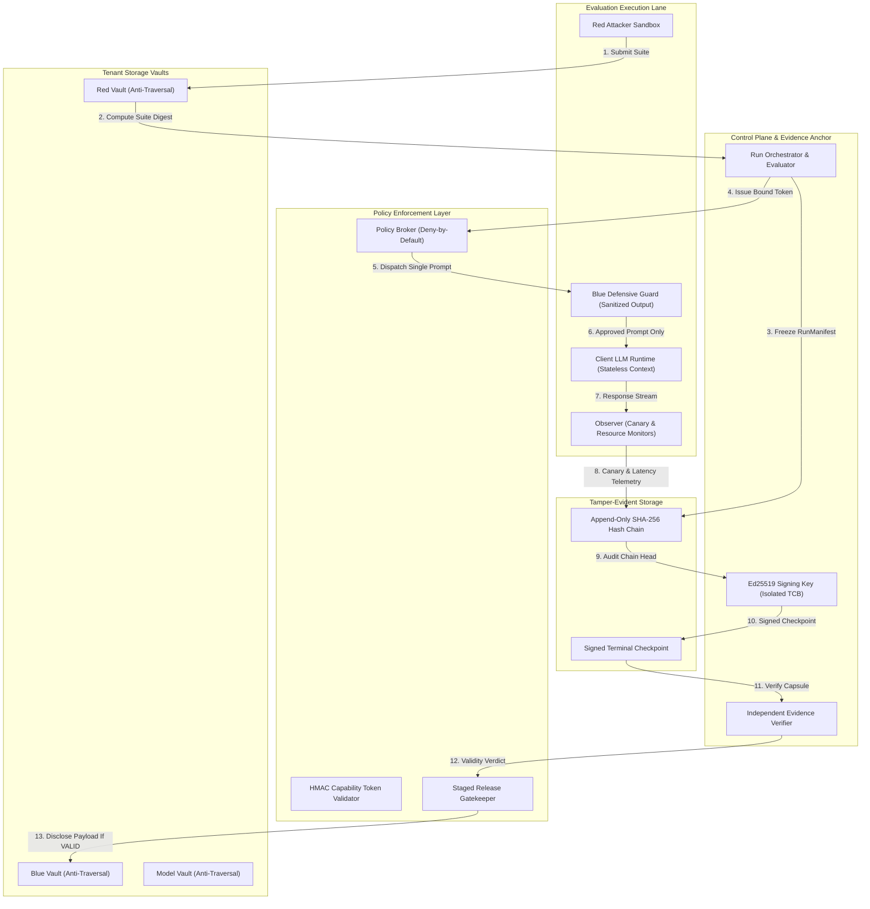

# Bayora BlindSeal: System Architecture & Data Flows

## 1. Logical Architecture



---

## 2. The Four Stages of the Protocol: Seal → Run → Verify → Release

### Stage 1: SEAL (Pre-Execution Commitment)
1. Red team submits an adversarial test suite into its private vault (`red/`).
2. Blue team submits its defensive rule package into its private vault (`blue/`).
3. The orchestrator computes canonical digests (RFC 8785 + SHA-256) of:
   - `test_suite_digest`
   - `defense_digest`
   - `model_digest`
   - `policy_digest`
   - `resource_profile`
4. A canonical `RunManifest` is constructed and committed as the genesis of the evaluation run. Neither team can alter their artifacts post-seal without invalidating the run.

### Stage 2: RUN (Blinded, Isolated Execution)
1. The broker issues short-lived capability tokens cryptographically bound to the authenticated actor, tenant, roles, expiration timestamp, and specific `run_id`.
2. Each test case runs in a freshly initialized, stateless session context (`session_id`).
3. Prompts route through the frozen `BlueGuardRuntime`. The guard evaluates prompts, logging forensic audit details privately, but returns **strictly sanitized responses** to Red (`BLOCKED` or `PERMITTED`) without exposing internal rule IDs, regex patterns, or confidence thresholds.
4. The `CanaryTripwireDetector` generates a unique synthetic canary marker per test case (`CANARY_TOKEN_<run_id>_<test_id>_<entropy>`).
5. The `ResourceGovernanceMonitor` measures CPU times, resident memory (RSS), and latency.
6. The broker appends structured `AuditEvent` records to the hash chain. **Raw prompts and model outputs are excluded from audit logs.**

### Stage 3: VERIFY (Independent Environmental Audit)
1. Upon run completion, the orchestrator appends `EXECUTION_COMPLETED` and `CHECKPOINT_CREATED` events.
2. The trusted evaluator service signs a `RunCheckpoint` over canonical signing bytes:
   - `run_id`
   - `manifest_digest`
   - `event_count`
   - `final_sequence_number`
   - `final_event_hash`
   using an **Ed25519 private key**.
3. An independent verifier audits the resulting `EvidenceCapsule`:
   - Checks checkpoint Ed25519 signature against trusted public key (detecting key substitution).
   - Verifies manifest digest match against checkpoint.
   - Verifies total event count and final sequence number (detecting truncation).
   - Recalculates canonical SHA-256 hash for every event body from sequence 0 to $N-1$ (detecting field modifications).
   - Verifies sequence monotonicity and previous-hash continuity (detecting reordering or deletion).
   - Scans events for critical tripwire signals (`CANARY_PROBE` breach or `RESOURCE_CHECK` violation).
4. Assigns exactly one deterministic verdict: `VALID`, `INVALIDATED`, `INCONCLUSIVE`, or `NOT_EVALUATED`.

### Stage 4: RELEASE (Staged Red Disclosure)
1. Prior to verification, Red test payloads remain in `SEALED` or `BLINDED` release state. Blue read access is denied (`RED_PAYLOAD_UNRELEASED`).
2. If the validity gate returns `VALID`, the artifact release state transitions to `VERIFIED`.
3. An authorized evaluator request transitions the artifact to `RELEASED`. Blue team can now inspect the revealed test case.
4. If the validity gate returns `INVALIDATED` or `INCONCLUSIVE`, the release state is set to `REJECTED`. Release requests are **strictly forbidden** (`INVALIDATED_RUN_RELEASE_FORBIDDEN`), preventing unverified or compromised test payload leakage.

---

## 3. Cryptographic Invariants & Chains

### Deterministic Canonical Serialization (RFC 8785)
All hashing operates over canonical JSON bytes:
- Keys sorted lexicographically by Unicode scalar values.
- No whitespace between tokens (`separators=(',', ':')`).
- Integers formatted without trailing decimals.
- UTF-8 encoded.

### Append-Only Event Hash Chain
```text
event_hash[0] = SHA-256( canonical_json(event[0] - hash) || "0"*64 )
event_hash[i] = SHA-256( canonical_json(event[i] - hash) || event_hash[i-1] )
```

### Checkpoint Signature Binding
```text
checkpoint_bytes = canonical_json({
    "run_id": run_id,
    "manifest_digest": manifest_digest,
    "event_count": N,
    "final_sequence_number": N - 1,
    "final_event_hash": event_hash[N - 1],
    "created_at": timestamp
})
signature = Ed25519_Sign(private_key, checkpoint_bytes)
```
Any deletion, reordering, truncation, or payload modification invalidates the signature or breaks the chain.
